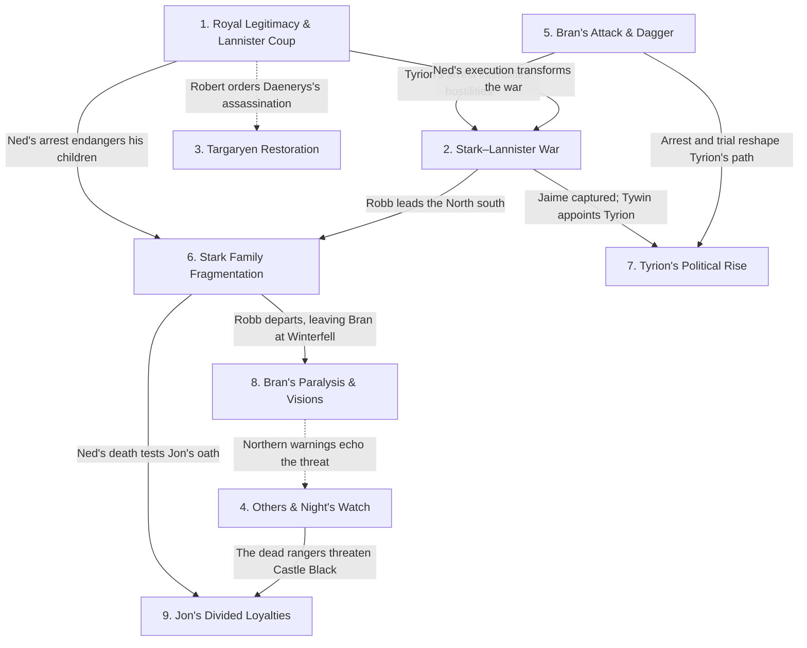

# ROM MNT — A Game of Thrones

**Work:** *A Game of Thrones* — George R. R. Martin  
**Scope:** Whole Book · Prologue + GOT Ch. 1–72 (73 narrative units)  
**Spoiler Boundary:** End of GOT Ch. 72 (Daenerys X)  
**Ranking Basis:** Final narrative significance across the completed novel, synthesised and reconciled from all nine POV-local SROMX MNTs.

> **Full-book spoilers:** This report synthesises every POV and discloses the novel's political outcomes, character deaths, supernatural events and other revelations through the final chapter.

**Repository:** [Reading Index](../README.md) · [ROM CSRM](ROM_CSRM_AGOT.md) · [ROM MCM](ROM_MCM_AGOT.md)

## Table of Contents

- [1. The Crisis of Royal Legitimacy and the Lannister Seizure of the Throne](#mnt-1)
- [2. The Stark–Lannister War and the Emergence of Northern Independence](#mnt-2)
- [3. The Targaryen Restoration Bid and the Rebirth of Dragons](#mnt-3)
- [4. The Return of the Others and the Night's Watch Crisis](#mnt-4)
- [5. Bran's Assassination Attempt and the Dagger Accusation](#mnt-5)
- [6. The Fragmentation and Endangerment of House Stark](#mnt-6)
- [7. Tyrion's Transformation from Political Prisoner to Acting Hand](#mnt-7)
- [8. Bran's Paralysis, Uncanny Dreams and Growing Authority at Winterfell](#mnt-8)
- [9. Jon Snow's Divided Loyalties and the Forging of a New Brotherhood](#mnt-9)
- [Flow Chart](#mnt-flowchart)
- [Appendix: Document Notes](#mnt-notes)

# 1. The Crisis of Royal Legitimacy and the Lannister Seizure of the Throne

| **JOFFREY'S CLAIM AND LANNISTER CONTROL** | **NED'S DEFENCE OF STANNIS'S SUCCESSION** |
|---|---|
| **CERSEI LANNISTER** — Secures the throne for her son and controls the royal household. | **EDDARD STARK** — Investigates the succession and attempts to uphold the lawful inheritance. |
| **JOFFREY BARATHEON** — Claims the crown and exercises royal authority. | **STANNIS BARATHEON** — Robert's brother, identified by Ned as the rightful successor; remains absent from the capital. |
| **PETYR BAELISH** — Betrays Ned and helps deliver the City Watch to Cersei. | |
| **JANOS SLYNT** — Commands the City Watch during the coup. | |
| **GRAND MAESTER PYCELLE** — Supports the new regime through the royal administration. | |

The death of **Jon Arryn** brings **Eddard Stark** to **King's Landing**, where his investigation establishes that **Cersei's** children were fathered by **Jaime Lannister** rather than **Robert Baratheon**. Ned's attempt to protect the lawful succession collapses when Robert dies and **Littlefinger** betrays him. **Joffrey** takes the throne, Ned is imprisoned, and his execution transforms a disputed regency into an open dynastic crisis. With **Stannis** and **Renly Baratheon** advancing competing claims, the monarchy's legitimacy remains unresolved.

<a href="#mnt-toc" title="Return to Table of Contents"><kbd>↑</kbd></a>

---

# 2. The Stark–Lannister War and the Emergence of Northern Independence

| **STARK–TULLY WAR EFFORT** | **LANNISTER WAR EFFORT** |
|---|---|
| **ROBB STARK** — Commands the northern army and becomes King in the North. | **TYWIN LANNISTER** — Directs the western armies and their riverlands campaign. |
| **CATELYN STARK** — Advises Robb and negotiates essential alliances. | **JAIME LANNISTER** — Commands forces besieging Riverrun before his capture. |
| **BRYNDEN TULLY** — Provides military experience and supports the Stark campaign. | **GREGOR CLEGANE** — Conducts destructive operations against riverlands settlements. |
| **EDMURE TULLY** — Defends his family's interests in the riverlands. | **TYRION LANNISTER** — Brings mountain-clan fighters into Tywin's army and survives the Green Fork. |
| **WALDER FREY** — Grants passage and support in exchange for negotiated obligations. | **KEVAN LANNISTER** — Helps coordinate Tywin's campaign. |

What begins with suspicion over **Bran's** attempted murder escalates through **Tyrion's** arrest, **Jaime's** attack on Ned's household and Lannister raids into the riverlands. After **Ned's** imprisonment, **Robb** marches south, secures passage across the **Twins**, divides his forces and captures Jaime while relieving **Riverrun**. His military success and Ned's execution drive the northern lords beyond demands for justice or negotiation. They proclaim Robb **King in the North**, turning a conflict between noble houses into a struggle over the realm's political unity.

<a href="#mnt-toc" title="Return to Table of Contents"><kbd>↑</kbd></a>

---

# 3. The Targaryen Restoration Bid and the Rebirth of Dragons

| **TARGARYEN RESTORATION AND SURVIVAL** | **BARATHEON DEFENCE OF THE CROWN** |
|---|---|
| **DAENERYS TARGARYEN** — Develops from a political bargaining piece into an independent claimant. | **ROBERT BARATHEON** — Seeks to eliminate the surviving Targaryen threat and authorises Daenerys's assassination. |
| **VISERYS TARGARYEN** — Demands a Dothraki army to restore his dynasty. | |
| **KHAL DROGO** — Initially resists invasion, then vows to conquer Westeros for his son. | |
| **JORAH MORMONT** — Protects and advises Daenerys, ultimately becoming her sworn Queensguard. | |
| **ILLYRIO MOPATIS** — Sponsors the marriage arrangement and provides the dragon eggs. | |

Across the **narrow sea**, **Viserys** trades **Daenerys's** marriage to **Drogo** for the promise of military assistance in reclaiming **Westeros**. Viserys dies, while an assassination attempt against Daenerys prompts Drogo to promise an invasion. His subsequent wound and **Mirri Maz Duur's** blood magic leave him incapacitated, and Daenerys loses her unborn son and most of the khalasar. She nevertheless emerges from Drogo's funeral pyre with 3 living dragons, transforming a failed restoration scheme into an independent claim supported by the return of a power long absent from the world.

<a href="#mnt-toc" title="Return to Table of Contents"><kbd>↑</kbd></a>

---

# 4. The Return of the Others and the Night's Watch Crisis

| **THE NIGHT'S WATCH AND ITS RANGERS** | **SUPERNATURAL THREATS BEYOND THE WALL** |
|---|---|
| **JEOR MORMONT** — Directs the Watch's investigation and plans a major ranging. | **THE OTHERS** — Kill Waymar Royce during a supernatural encounter in the Haunted Forest. |
| **WAYMAR ROYCE** — Confronts the Others during a fatal ranging. | **REANIMATED RANGERS** — Present an immediate lethal threat within Castle Black. |
| **WILL** — Witnesses the Others and is killed by the reanimated Waymar. | |
| **BENJEN STARK** — Leads a ranging into the Haunted Forest and disappears. | |
| **JON SNOW** — Defends the Lord Commander against a reanimated ranger. | |

The **Prologue** establishes a supernatural menace when pale warriors kill **Waymar Royce**, whose corpse subsequently rises against **Will**. Farther into the novel, **Benjen Stark** vanishes beyond **the Wall**. The bodies of **Othor** and **Jafer Flowers** are recovered in unnatural condition and rise inside **Castle Black**, where **Jon Snow** destroys Othor with fire. With the Watch undermanned, its outlying castles neglected and the danger still poorly understood, **Jeor Mormont** prepares a major expedition north. The scale and origin of the threat remain unresolved.

<a href="#mnt-toc" title="Return to Table of Contents"><kbd>↑</kbd></a>

---

# 5. Bran's Assassination Attempt and the Dagger Accusation

| **STARK INVESTIGATION AND ACCUSATION** | **TYRION'S DEFENCE AGAINST THE CHARGES** |
|---|---|
| **CATELYN STARK** — Searches for the person responsible for the attempt on Bran's life. | **TYRION LANNISTER** — Denies possessing the dagger as alleged and rejects responsibility for the attack. |
| **EDDARD STARK** — Receives evidence brought from Winterfell amid his own investigation. | **BRONN** — Defends Tyrion on the High Road and becomes his champion in the Vale. |
| **LYSA ARRYN** — Imprisons Tyrion and presses additional accusations concerning Jon Arryn's death. | |

**Jaime Lannister** pushes **Bran Stark** from a tower after Bran witnesses him with **Cersei**. Later, an unidentified attacker attempts to murder the unconscious boy using a distinctive dagger. **Catelyn** takes the weapon to **King's Landing**, where **Petyr Baelish** falsely attributes its ownership to **Tyrion**. Catelyn's subsequent arrest of Tyrion intensifies hostilities between the great houses. His release through trial by combat resolves neither the murder attempt nor the dagger's ownership. By the novel's end, the identity of the person who ordered Bran's assassination remains unknown.

<a href="#mnt-toc" title="Return to Table of Contents"><kbd>↑</kbd></a>

---

# 6. The Fragmentation and Endangerment of House Stark

| Character | Role in MNT |
|---|---|
| **EDDARD STARK** | Attempts to protect his household before his arrest and execution. |
| **CATELYN STARK** | Struggles to preserve the family while northern military obligations intensify. |
| **SANSA STARK** | Becomes a captive of Joffrey's court and an instrument of Lannister pressure. |
| **ARYA STARK** | Escapes the Red Keep and survives in hiding before Yoren intervenes. |
| **ROBB STARK** | Assumes command of the North and becomes responsible for its political future. |
| **BRAN STARK** | Remains at Winterfell, increasingly dependent on others as his family departs. |
| **JON SNOW** | Separates from his siblings and struggles between family loyalty and sworn duty. |

The royal appointment that initially elevates **House Stark** gradually dismantles its security. **Ned** takes his daughters south while **Catelyn** investigates the attack on **Bran**. His fall leaves **Sansa** captive, **Arya** missing from her family's knowledge and **Robb** leading northern armies. Bran and **Rickon** remain in **Winterfell**, while **Jon** is bound to the **Night's Watch**. By the novel's conclusion, the family has lost its patriarch and its former unity, with each surviving member confronting a different struggle for survival, protection or responsibility.

<a href="#mnt-toc" title="Return to Table of Contents"><kbd>↑</kbd></a>

---

# 7. Tyrion's Transformation from Political Prisoner to Acting Hand

| Character | Role in MNT |
|---|---|
| **TYRION LANNISTER** | Principal Driver, seeking survival, freedom and greater agency within his family. |
| **CATELYN STARK** | Initiates the arrest that threatens Tyrion's life and position. |
| **LYSA ARRYN** | Imprisons Tyrion and subjects him to trial in the Vale. |
| **BRONN** | Secures Tyrion's freedom and becomes his dependable military companion. |
| **SHAGGA** | Helps establish Tyrion's authority among the mountain clans. |
| **TYWIN LANNISTER** | Exercises paternal and military authority before unexpectedly appointing Tyrion acting Hand. |
| **SHAE** | Becomes Tyrion's companion and a source of conflict with Tywin's instructions. |

**Tyrion Lannister's** journey transforms an apparently expendable member of **House Lannister** into a political actor entrusted with the capital. Wrongly accused of attempting to murder **Bran**, he survives the dangerous journey to the **Eyrie**, escapes through **Bronn's** intervention and recruits fighters from the mountain clans. He then fights in **Tywin's** army at the **Green Fork**. When **Jaime** is captured and royal government deteriorates, Tywin appoints Tyrion acting Hand. The promotion grants him substantial responsibility without resolving his father's contempt or the tensions surrounding **Shae**.

<a href="#mnt-toc" title="Return to Table of Contents"><kbd>↑</kbd></a>

---

# 8. Bran's Paralysis, Uncanny Dreams and Growing Authority at Winterfell

| Character | Role in MNT |
|---|---|
| **BRAN STARK** | Principal Driver, adapting to paralysis while experiencing mysterious dreams and new responsibilities. |
| **MAESTER LUWIN** | Provides education, practical guidance and sceptical explanations of supernatural claims. |
| **HODOR** | Enables Bran's physical movement and increasing independence. |
| **SUMMER** | Protects Bran and displays behaviour that intensifies the mystery surrounding the direwolves. |
| **OSHA** | Warns of ancient northern dangers and the significance of events beyond the Wall. |
| **ROBB STARK** | Assumes Winterfell's responsibilities before leaving Bran to represent the family. |

After surviving his fall, **Bran Stark** awakens without the use of his legs and struggles to recover a sense of independence. A specially designed saddle and **Hodor's** assistance restore some mobility, while his direwolf **Summer** becomes integral to his protection. Meanwhile, recurring dreams of a **three-eyed crow**, strange visions and **Osha's** warnings suggest forces beyond ordinary understanding. With **Robb** leading the northern army, Bran must also participate in **Winterfell's** government. The nature of his experiences remains unresolved, but his condition and responsibilities are permanently transformed.

<a href="#mnt-toc" title="Return to Table of Contents"><kbd>↑</kbd></a>

---

# 9. Jon Snow's Divided Loyalties and the Forging of a New Brotherhood

| Character | Role in MNT |
|---|---|
| **JON SNOW** | Principal Driver, seeking belonging and honour while confronting divided loyalties. |
| **BENJEN STARK** | Inspires Jon's initial decision to join the Watch while warning of its sacrifices. |
| **DONAL NOYE** | Challenges Jon's arrogance and encourages him to understand his fellow recruits. |
| **SAMWELL TARLY** | Becomes Jon's close friend and benefits from his protection. |
| **MAESTER AEMON** | Explains the conflict between personal love and sworn duty. |
| **JEOR MORMONT** | Mentors Jon, rewards his courage and prepares him for greater service. |
| **PYP AND GRENN** | Represent the brotherhood that ultimately helps Jon return to his oath. |

Feeling excluded at **Winterfell**, **Jon Snow** joins the **Night's Watch** in search of identity and purpose. His early superiority over poorly trained recruits gives way to solidarity, especially through his defence of **Samwell Tarly**. After saving **Jeor Mormont** from a reanimated ranger, he receives **Longclaw** and begins serving close to command. News of **Ned's** execution drives him to abandon the Watch and ride towards **Robb**, but his brothers bring him back. Jon ultimately chooses his oath, accepting a new allegiance as Mormont prepares to investigate the danger beyond the **Wall**.

<a href="#mnt-toc" title="Return to Table of Contents"><kbd>↑</kbd></a>

## Flow Chart

<a href="#mnt-toc" title="Return to Table of Contents"><kbd>↑</kbd></a>

## Appendix: Document Notes

> **Synthesis and ranking — Applies to: Entries 1–9:** This record is a final, whole-book reconciliation of 9 independent POV-local SROMX Major Narrative Thread assessments. Local threads concerning succession, family protection, invasion, war, supernatural danger and character transformations were compared for causal overlap and book-wide importance, not simply concatenated. Rankings reflect only *A Game of Thrones* through its ending.

> **Primary source and continuity — Applies to: Entire document:** Source authority is the project's supplied complete *A Game of Thrones* EPUB, with [ROM CSRM](ROM_CSRM_AGOT.md) furnishing chapter chronology and [ROM MCM](ROM_MCM_AGOT.md) furnishing character continuity and book-wide significance. The Prologue narrator Will is included as the ninth POV. Facts from later books and the television adaptation are outside Scope.

> **POV-local source documents — Applies to: Entries 1–9:** The 9 underlying reconstructions are:
>
> - [SROMX | Will](./SROMX_GOT_POV_WILL.md)
> - [SROMX | Bran Stark](./SROMX_GOT_POV_BRAN.md)
> - [SROMX | Catelyn Stark](./SROMX_GOT_POV_CATELYN.md)
> - [SROMX | Daenerys Targaryen](./SROMX_GOT_POV_DAENERYS.md)
> - [SROMX | Eddard Stark](./SROMX_GOT_POV_EDDARD.md)
> - [SROMX | Jon Snow](./SROMX_GOT_POV_JON.md)
> - [SROMX | Arya Stark](./SROMX_GOT_POV_ARYA.md)
> - [SROMX | Tyrion Lannister](./SROMX_GOT_POV_TYRION.md)
> - [SROMX | Sansa Stark](./SROMX_GOT_POV_SANSA.md)

> **Explanatory Field limits — Applies to: Entries 1–9:** Each explanatory prose Field remains beneath the hard 800-visible-character ceiling of [ROM MNT v10.18](https://github.com/dz480/CG-Protocols/blob/main/ROM/ANALYSIS/ROM_MNT.md), excluding table, title, presentation anchors and source notes. The MNT headings, participant tables and diagram reflect this manual, while whole-book navigation follows [ChatGPT ↔ GitHub Workflow v1.3](https://github.com/dz480/CG-GitHub/blob/main/CHATGPT_GITHUB_WORKFLOW.md).

> **Relationship certainty — Applies to: [Flow Chart](#mnt-flowchart):** Solid arrows show source-established causal effects across threads; dotted arrows show looser dynastic or thematic connections. The royal assassination order against Daenerys predates Robert's death and Joffrey's succession. Bran's northern warnings do not establish that he has witnessed the Others first-hand.

> **Prologue death distinction — Applies to: Entry 4:** The Others kill Waymar Royce; his reanimated corpse kills Will. Gared remains alive at the end of the Prologue, while the eight missing wildlings cannot be certified dead from Will's account.
