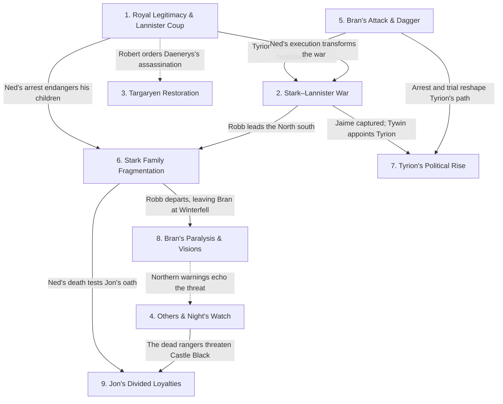

# ROM MNT — A Game of Thrones

**Work:** *A Game of Thrones* — George R. R. Martin  
**Scope:** Whole Book · Prologue + GOT Ch. 1–72 (73 narrative units)  
**Spoiler Boundary:** End of GOT Ch. 72 (Daenerys X)  
**Ranking Basis:** Final narrative significance across the completed novel, synthesised and reconciled from all 9 POV-local SROMX MNTs.  
**Last Updated:** 14 Oct 2026 · ROM MNT v10.22

> **Full-book spoilers:** This report synthesises every POV and discloses the novel's political outcomes, character deaths, supernatural events and other revelations through the final chapter.

**Repository:** [Reading Index](../README.md) · [ROM CSRM](ROM_CSRM_AGOT.md) · [ROM MCM](ROM_MCM_AGOT.md)

## Table of Contents

- [1. The Crisis of Royal Legitimacy and the Lannister Seizure of the Throne](#mnt-1)
- [2. The Stark–Lannister War and the Emergence of Northern Independence](#mnt-2)
- [3. The Targaryen Restoration Bid and the Rebirth of Dragons](#mnt-3)
- [4. The Return of the Others and the Night's Watch Crisis](#mnt-4)
- [5. Bran's Assassination Attempt and the Dagger Accusation](#mnt-5)
- [6. The Fragmentation and Endangerment of House Stark](#mnt-6)
- [7. Tyrion's Transformation from Political Prisoner to Acting Hand](#mnt-7)
- [8. Bran's Paralysis, Uncanny Dreams and Growing Authority at Winterfell](#mnt-8)
- [9. Jon Snow's Divided Loyalties and the Forging of a New Brotherhood](#mnt-9)
- [Flow Chart](#mnt-flowchart)
- [Appendix: Document Notes](#mnt-notes)

# 1. The Crisis of Royal Legitimacy and the Lannister Seizure of the Throne

| **JOFFREY'S CLAIM AND LANNISTER CONTROL** | **NED'S DEFENCE OF STANNIS'S SUCCESSION** | **RENLY'S RIVAL CLAIM** |
|---|---|---|
| **CERSEI LANNISTER** — Secures the throne for her son and controls the royal household. | **EDDARD STARK** — Investigates the succession and attempts to uphold lawful inheritance. | **RENLY BARATHEON** — Claims the crown after Robert's death and marries into House Tyrell. |
| **JOFFREY BARATHEON** — Takes the crown and exercises royal authority. | **STANNIS BARATHEON** — Robert's elder surviving brother and lawful successor if Joffrey is illegitimate; absent from the capital. | **MACE TYRELL** — Backs Renly's kingship with Highgarden's support. |
| **PETYR BAELISH** — Betrays Ned and helps deliver the City Watch to Cersei. | | **LORAS TYRELL** — Accompanies Renly from the capital and supports his cause. |
| **JANOS SLYNT** — Commands the City Watch during the coup. | | |
| **GRAND MAESTER PYCELLE** — Supports the new regime through the royal administration. | | |

**Cersei Lannister** seeks to preserve her children's position and the power of her household, while **Eddard Stark** is determined to honour **Robert Baratheon's** succession and protect the children from the consequences of exposing their parentage. The death of **Jon Arryn** draws Ned to **King's Landing**, where he discovers that **Joffrey** and his siblings are **Jaime Lannister's** children.

Ned identifies **Stannis Baratheon** as the lawful heir but delays action to warn Cersei. **Robert's** failing authority leaves the king's council divided between personal loyalty, dynastic calculation and competing succession plans. The legal answer matters only if someone can enforce it.

After Robert's fatal hunt, **Petyr Baelish** delivers the **City Watch** to the queen; Joffrey takes the throne and Ned is imprisoned. His execution destroys the prospect of a negotiated transition, while **Renly Baratheon's** separate coronation and Stannis's competing right leave royal legitimacy contested.

<a href="#mnt-toc" title="Return to Table of Contents"><kbd>↑</kbd></a>

---

# 2. The Stark–Lannister War and the Emergence of Northern Independence

| **STARK–TULLY WAR EFFORT** | **LANNISTER WAR EFFORT** |
|---|---|
| **ROBB STARK** — Commands the northern army and becomes King in the North. | **TYWIN LANNISTER** — Directs the western armies and their riverlands campaign. |
| **CATELYN STARK** — Advises Robb and negotiates essential alliances. | **JAIME LANNISTER** — Commands forces besieging Riverrun before his capture. |
| **BRYNDEN TULLY** — Provides military experience and supports the Stark campaign. | **GREGOR CLEGANE** — Conducts destructive operations against riverlands settlements. |
| **EDMURE TULLY** — Defends his family's interests in the riverlands. | **TYRION LANNISTER** — Brings mountain-clan fighters into Tywin's army and survives the Green Fork. |
| **WALDER FREY** — Grants passage and support in exchange for negotiated obligations. | **KEVAN LANNISTER** — Helps coordinate Tywin's campaign. |

**Robb Stark** seeks to free his father, defend **House Stark** and protect his **Tully** kin from **Tywin Lannister's** campaign, while Tywin aims to preserve Lannister power and retaliate for **Tyrion's** capture. As **Catelyn Stark** tries to safeguard her children and secure allies, **Jaime Lannister's** attack on **Eddard Stark's** household and raids through the **riverlands** turn the dispute into war.

Robb bargains with **Walder Frey** for passage at the **Twins**, dividing his forces between the **Green Fork** and an assault on Jaime's army. The riverlords' exposure to raids forces northern strategy to serve both homeland ambitions and allied territories. Robb's victories create a powerful bargaining position but no settlement with the Iron Throne.

He captures Jaime and helps relieve **Riverrun**, gaining leverage but failing to recover his father. Ned's execution makes accommodation less likely; the northern lords proclaim Robb **King in the North**, asserting independence and challenging the political unity of the realm.

<a href="#mnt-toc" title="Return to Table of Contents"><kbd>↑</kbd></a>

---

# 3. The Targaryen Restoration Bid and the Rebirth of Dragons

| **TARGARYEN RESTORATION AND SURVIVAL** | **BARATHEON DEFENCE OF THE CROWN** |
|---|---|
| **DAENERYS TARGARYEN** — Develops from a political bargaining piece into an independent claimant. | **ROBERT BARATHEON** — Seeks to eliminate the surviving Targaryen threat and authorises Daenerys's assassination. |
| **VISERYS TARGARYEN** — Demands a Dothraki army to restore his dynasty. | |
| **KHAL DROGO** — Initially resists invasion, then vows to conquer Westeros for his son. | |
| **JORAH MORMONT** — Protects and advises Daenerys, ultimately becoming her sworn Queensguard. | |
| **ILLYRIO MOPATIS** — Sponsors the marriage arrangement and provides the dragon eggs. | |

**Viserys Targaryen** wants a Dothraki army to restore his dispossessed dynasty, while **Daenerys** initially has little choice in the marriage arranged with **Khal Drogo**. **Robert Baratheon** considers the surviving Targaryens a threat to his throne. Across the **narrow sea**, Daenerys acquires confidence and authority within the khalasar, but her brother's demands end in his death.

An attempt on her life prompts Drogo to vow to invade **Westeros** for her and their unborn son. **Jorah Mormont** advises Daenerys as she learns to command people who once viewed her only as a foreign bride. The surviving khalasar is small, making the dragons a startling source of renewed possibility rather than an established army.

When Drogo is wounded and **Mirri Maz Duur's** blood magic leaves him unable to lead, Daenerys loses her child and most of his followers. She acts independently at his funeral pyre, emerging with 3 living dragons. The failed restoration scheme becomes a new claim rooted in Daenerys's survival and the return of dragons.

<a href="#mnt-toc" title="Return to Table of Contents"><kbd>↑</kbd></a>

---

# 4. The Return of the Others and the Night's Watch Crisis

| **THE NIGHT'S WATCH AND ITS RANGERS** | **SUPERNATURAL THREATS BEYOND THE WALL** |
|---|---|
| **JEOR MORMONT** — Directs the Watch's investigation and plans a major ranging. | **THE OTHERS** — Kill Waymar Royce during a supernatural encounter in the Haunted Forest. |
| **WAYMAR ROYCE** — Confronts the Others during a fatal ranging. | **REANIMATED RANGERS** — Present an immediate lethal threat within Castle Black. |
| **WILL** — Witnesses the Others and is killed by the reanimated Waymar. | |
| **BENJEN STARK** — Leads a ranging into the Haunted Forest and disappears. | |
| **JON SNOW** — Defends the Lord Commander against a reanimated ranger. | |

The **Night's Watch** is sworn to protect the realm from dangers beyond **the Wall**, but depleted ranks, neglected castles and uncertainty about the enemy undermine its capacity to respond. In the **Haunted Forest**, the **Others** kill **Waymar Royce**, whose reanimated corpse then kills **Will**.

Later, **Benjen Stark** vanishes on a ranging, and the bodies of **Othor** and **Jafer Flowers** rise inside **Castle Black**; **Jon Snow** saves **Jeor Mormont** by burning Othor. **Mormont** receives evidence that ordinary weapons and patrols cannot reliably protect the Watch against what has appeared.

The decision to venture north risks the few trained men still available to defend the Wall. Facing disappearances and lethal phenomena it cannot explain, the Watch prepares a major expedition north under Mormont. Neither the full extent of the threat nor the relationship between the Others and the reanimated dead is established.

<a href="#mnt-toc" title="Return to Table of Contents"><kbd>↑</kbd></a>

---

# 5. Bran's Assassination Attempt and the Dagger Accusation

| **STARK INVESTIGATION AND ACCUSATION** | **TYRION'S DEFENCE AGAINST THE CHARGES** |
|---|---|
| **CATELYN STARK** — Searches for the person responsible for the attempt on Bran's life. | **TYRION LANNISTER** — Denies possessing the dagger as alleged and rejects responsibility for the attack. |
| **EDDARD STARK** — Receives evidence brought from Winterfell amid his own investigation. | **BRONN** — Defends Tyrion on the High Road and becomes his champion in the Vale. |
| **LYSA ARRYN** — Imprisons Tyrion and presses additional accusations concerning Jon Arryn's death. | |

**Catelyn Stark** wants to protect **Bran** and find whoever tried to kill him, while **Tyrion Lannister** must defend his freedom and reputation against an accusation he rejects. **Jaime Lannister** pushed Bran from a tower after the boy witnessed him with **Cersei**, but the later assassination attempt is a separate, unresolved crime.

Its distinctive dagger takes Catelyn to **King's Landing**, where **Petyr Baelish** claims Tyrion once owned the blade. **Lysa** rejects Catelyn's expectation of allied help and subjects Tyrion to the Vale's judgment on her own terms. The arrest converts suspicion into a diplomatic and military crisis long before its central allegation is verified.

Catelyn arrests Tyrion; **Lysa Arryn** imprisons him in the **Eyrie** and also accuses him of involvement in **Jon Arryn's** death. **Bronn** wins Tyrion's freedom through trial by combat, but his arrest has already intensified conflict between the houses. The dagger's actual ownership and the instigator of the murder attempt remain unproved.

<a href="#mnt-toc" title="Return to Table of Contents"><kbd>↑</kbd></a>

---

# 6. The Fragmentation and Endangerment of House Stark

| Character | Role in MNT |
|---|---|
| **EDDARD STARK** | Attempts to protect his household before his arrest and execution. |
| **CATELYN STARK** | Struggles to preserve the family while northern military obligations intensify. |
| **SANSA STARK** | Becomes a captive of Joffrey's court and an instrument of Lannister pressure. |
| **ARYA STARK** | Escapes the Red Keep and survives in hiding before Yoren intervenes. |
| **ROBB STARK** | Assumes command of the North and becomes responsible for its political future. |
| **BRAN STARK** | Remains at Winterfell, increasingly dependent on others as his family departs. |
| **JON SNOW** | Separates from his siblings and struggles between family loyalty and sworn duty. |

**Eddard Stark** seeks to serve his king while protecting his children and the security of **Winterfell**, but royal service and mounting political danger pull **House Stark** into separate, increasingly precarious lives. Ned takes **Sansa** and **Arya** to **King's Landing**, while **Catelyn** leaves home to investigate **Bran's** attempted murder.

With Ned arrested and then executed, Sansa remains a hostage at court and Arya escapes the city under **Yoren's** protection. Each separation answers a different pressure: court politics, wartime command, the protection of Winterfell and the oath binding Jon. The family can no longer respond to danger with shared knowledge or common action.

**Robb** commands the northern armies, leaving Bran and **Rickon** at Winterfell; **Jon Snow**, meanwhile, must choose between family loyalty and the **Night's Watch**. The survivors pursue safety, justice or duty in different places, deprived of their former unity and their father's protection.

<a href="#mnt-toc" title="Return to Table of Contents"><kbd>↑</kbd></a>

---

# 7. Tyrion's Transformation from Political Prisoner to Acting Hand

| Character | Role in MNT |
|---|---|
| **TYRION LANNISTER** | Principal Driver, seeking survival, freedom and greater agency within his family. |
| **CATELYN STARK** | Initiates the arrest that threatens Tyrion's life and position. |
| **LYSA ARRYN** | Imprisons Tyrion and subjects him to trial in the Vale. |
| **BRONN** | Secures Tyrion's freedom and becomes his dependable military companion. |
| **SHAGGA** | Helps establish Tyrion's authority among the mountain clans. |
| **TYWIN LANNISTER** | Exercises paternal and military authority before unexpectedly appointing Tyrion acting Hand. |
| **SHAE** | Becomes Tyrion's companion and a source of conflict with Tywin's instructions. |

**Tyrion Lannister** wants to survive, exercise his intelligence and secure a place in a family that habitually belittles him, but he begins with little power over his future. **Catelyn Stark's** arrest and **Lysa Arryn's** imprisonment threaten his life; **Bronn's** victory in trial by combat wins his freedom.

Tyrion recruits mountain-clan fighters on the return journey and joins **Tywin Lannister's** army, surviving the **Green Fork**. **Tywin** entrusts Tyrion with a capital ruled by family members whose competence and loyalty are uncertain. His political ascent is therefore also an assignment to manage a crisis from which his powerful relatives remain distant.

**Jaime's** capture and worsening instability in **King's Landing** then prompt Tywin to appoint Tyrion acting Hand. The unexpected promotion grants political influence and responsibility, but does not erase his father's contempt; Tywin's instructions concerning **Shae** threaten to complicate Tyrion's new authority.

<a href="#mnt-toc" title="Return to Table of Contents"><kbd>↑</kbd></a>

---

# 8. Bran's Paralysis, Uncanny Dreams and Growing Authority at Winterfell

| Character | Role in MNT |
|---|---|
| **BRAN STARK** | Principal Driver, adapting to paralysis while experiencing mysterious dreams and new responsibilities. |
| **MAESTER LUWIN** | Provides education, practical guidance and sceptical explanations of supernatural claims. |
| **HODOR** | Enables Bran's physical movement and increasing independence. |
| **SUMMER** | Protects Bran and displays behaviour that intensifies the mystery surrounding the direwolves. |
| **OSHA** | Warns of ancient northern dangers and the significance of events beyond the Wall. |
| **ROBB STARK** | Assumes Winterfell's responsibilities before leaving Bran to represent the family. |

**Bran Stark** longs to ride and pursue the knightly future he once imagined, but paralysis leaves him dependent on others just as **Winterfell** begins losing its adult protectors. **Maester Luwin** guides his adjustment, while **Hodor** and a specially designed saddle restore some mobility; his direwolf **Summer** becomes a fiercely protective companion.

Dreams of a **three-eyed crow** and other strange experiences resist ordinary explanation, and **Osha's** warnings about the far north deepen the mystery. Bran's duties require him to represent Stark rule before lords and guests despite the limitations of his age and injury.

His wolf's protective instincts contrast with his uncertainty about the deeper meaning of his dreams. As **Robb Stark** departs for war, Bran represents his household in receiving visitors and hearing petitions. He ends the novel with greater responsibilities but no clear understanding of his visions or their significance.

<a href="#mnt-toc" title="Return to Table of Contents"><kbd>↑</kbd></a>

---

# 9. Jon Snow's Divided Loyalties and the Forging of a New Brotherhood

| Character | Role in MNT |
|---|---|
| **JON SNOW** | Principal Driver, seeking belonging and honour while confronting divided loyalties. |
| **BENJEN STARK** | Inspires Jon's initial decision to join the Watch while warning of its sacrifices. |
| **DONAL NOYE** | Challenges Jon's arrogance and encourages him to understand his fellow recruits. |
| **SAMWELL TARLY** | Becomes Jon's close friend and benefits from his protection. |
| **MAESTER AEMON** | Explains the conflict between personal love and sworn duty. |
| **JEOR MORMONT** | Mentors Jon, rewards his courage and prepares him for greater service. |
| **PYP AND GRENN** | Represent the brotherhood that ultimately helps Jon return to his oath. |

**Jon Snow** seeks belonging and an honourable purpose beyond his uncertain place at **Winterfell**, but the **Night's Watch** demands hard service rather than the heroic brotherhood he imagined. At **Castle Black**, **Donal Noye** challenges his disdain for less capable recruits, while protecting **Samwell Tarly** teaches him solidarity.

**Jeor Mormont** brings Jon into his service after Jon saves him from a reanimated ranger, rewarding him with **Longclaw**. **Sam's** vulnerability exposes the gulf between the brotherhood's vows and the cruelty that weaker recruits endure. Jon's education involves learning to protect others without abandoning the discipline he has sworn to uphold.

**Eddard Stark's** execution sets family loyalty against his oath: Jon rides to join **Robb**, but **Pyp**, **Grenn** and other friends persuade him to return. **Maester Aemon's** counsel helps illuminate that choice. Jon stays with the Watch as Mormont prepares to range beyond **the Wall**, finding a new kind of family in the brotherhood.

<a href="#mnt-toc" title="Return to Table of Contents"><kbd>↑</kbd></a>

## Flow Chart

<a href="#mnt-toc" title="Return to Table of Contents"><kbd>↑</kbd></a>

## Appendix: Document Notes

> **Synthesis and ranking — Applies to: Entries 1–9:** This record is a final, whole-book reconciliation of 9 independent POV-local SROMX Major Narrative Thread assessments. Local threads concerning succession, family protection, invasion, war, supernatural danger and character transformations were compared for causal overlap and book-wide importance, not simply concatenated. Rankings reflect only *A Game of Thrones* through its ending.

> **Primary source and continuity — Applies to: Entire document:** Source authority is the project's supplied complete *A Game of Thrones* EPUB, with [ROM CSRM](ROM_CSRM_AGOT.md) furnishing chapter chronology and [ROM MCM](ROM_MCM_AGOT.md) furnishing character continuity and book-wide significance. The Prologue narrator Will is included as the ninth POV. Facts from later books and the television adaptation are outside Scope.

> **POV-local source documents — Applies to: Entries 1–9:** The 9 underlying reconstructions are:
>
> - [SROMX | Will](./SROMX_GOT_POV_WILL.md)
> - [SROMX | Bran Stark](./SROMX_GOT_POV_BRAN.md)
> - [SROMX | Catelyn Stark](./SROMX_GOT_POV_CATELYN.md)
> - [SROMX | Daenerys Targaryen](./SROMX_GOT_POV_DAENERYS.md)
> - [SROMX | Eddard Stark](./SROMX_GOT_POV_EDDARD.md)
> - [SROMX | Jon Snow](./SROMX_GOT_POV_JON.md)
> - [SROMX | Arya Stark](./SROMX_GOT_POV_ARYA.md)
> - [SROMX | Tyrion Lannister](./SROMX_GOT_POV_TYRION.md)
> - [SROMX | Sansa Stark](./SROMX_GOT_POV_SANSA.md)

> **ROM MNT compliance update (14 Oct 2026) — Applies to: Entries 1–9:** Reassessed all 9 explanations for source-supported motives, objectives, obstacles and stakes before causal narrative recap. Each complete explanatory prose Field uses at least 3 approximately balanced paragraphs and stays beneath the current 1,500-visible-character ceiling of [ROM MNT v10.21](https://github.com/dz480/CG-Protocols/blob/main/ROM/ANALYSIS/ROM_MNT.md), excluding its heading, table and navigation. Entry 1's participation matrix now distinguishes Renly's established independent royal claim from the Lannister regime and Ned's position on Stannis. The fixed Whole Book Scope and ranking are preserved; navigation follows the [ChatGPT ↔ GitHub Workflow](https://github.com/dz480/CG-GitHub/blob/main/CHATGPT_GITHUB_WORKFLOW.md).

> **Relationship certainty — Applies to: [Flow Chart](#mnt-flowchart):** Solid arrows show source-established causal effects across threads; dotted arrows show looser dynastic or thematic connections. The royal assassination order against Daenerys predates Robert's death and Joffrey's succession. Bran's northern warnings do not establish that he has witnessed the Others first-hand.

> **Prologue death distinction — Applies to: Entry 4:** The Others kill Waymar Royce; his reanimated corpse kills Will. Gared remains alive at the end of the Prologue, while the eight missing wildlings cannot be certified dead from Will's account.
