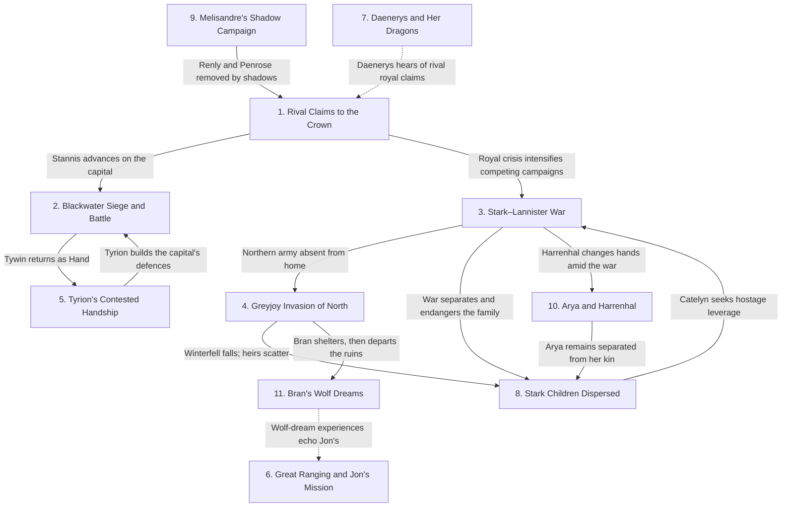

# ROM MNT — A Clash of Kings

**Work:** *A Clash of Kings* — George R. R. Martin  
**Scope:** Whole Book · Prologue + COK Ch. 1–69 (70 narrative units)  
**Spoiler Boundary:** End of COK Ch. 69 (Bran VII)  
**Ranking Basis:** Final narrative significance across the completed novel, independently synthesised and reconciled from all 10 POV-local SROMX MNT assessments.  
**Last Updated:** 14 Oct 2026 · ROM MNT v10.22

> **Full-book spoilers:** This report discloses events and outcomes across every chapter of *A Clash of Kings*. It does not incorporate later-book events.

**Repository:** [COK Reading Index](README.md) · [Series Reading Index](../README.md) · [ROM CSRM](ROM_CSRM_ACOK.md) · [ROM MCM](ROM_MCM_COK.md)

## Table of Contents

- [1. The War for the Iron Throne and the Fragmenting Baratheon Succession](#cok-mnt-1)
- [2. The Siege of King's Landing and the Battle of the Blackwater](#cok-mnt-2)
- [3. The Stark–Lannister War and the Strain on Northern Independence](#cok-mnt-3)
- [4. The Greyjoy Invasion of the North and the Destruction of Winterfell](#cok-mnt-4)
- [5. Tyrion's Contested Handship and the Struggle for Royal Government](#cok-mnt-5)
- [6. The Great Ranging, the Wildling Muster and Jon's Covert Mission](#cok-mnt-6)
- [7. Daenerys's Search for a Return West and the Defence of Her Dragons](#cok-mnt-7)
- [8. The Scattering of House Stark and the Struggle to Recover the Children](#cok-mnt-8)
- [9. Melisandre's Ascendancy and the Shadow-Assisted Campaign of Stannis](#cok-mnt-9)
- [10. Arya's Captivity, the Harrenhal Reversal and Her Escape](#cok-mnt-10)
- [11. Bran's Wolf Dreams and the Awakening of His Hidden Abilities](#cok-mnt-11)
- [Flow Chart](#cok-mnt-flowchart)
- [Appendix: Document Notes](#cok-mnt-notes)

# 1. The War for the Iron Throne and the Fragmenting Baratheon Succession

| **JOFFREY'S ROYAL CLAIM** | **STANNIS'S SENIOR CLAIM** | **RENLY'S RIVAL KINGSHIP** |
|---|---|---|
| **JOFFREY BARATHEON**: Occupies the throne and claims Robert's succession. | **STANNIS BARATHEON**: Claims the crown as Robert's elder surviving brother. | **RENLY BARATHEON**: Seeks the crown through personal popularity and a vast host. |
| **CERSEI LANNISTER**: Defends her son's crown and legitimacy. | **MELISANDRE**: Offers religious certainty and supernatural assistance. | **MARGAERY TYRELL**: Marries Renly in support of his original bid. |
| **TYWIN LANNISTER**: Directs the regime's military survival. | **DAVOS SEAWORTH**: Serves the king while questioning his means. | **LORAS TYRELL**: Supports Renly's cause before its collapse. |

**Joffrey Baratheon's** court must retain the throne despite the disputed parentage of **Cersei's** children. **Stannis Baratheon** considers himself Robert's lawful heir but lacks the backing he needs; his younger brother **Renly** values military support over strict succession and commands the greater host. Their incompatible claims prevent the anti-Lannister cooperation sought by **Catelyn Stark**.

Stannis circulates the incest allegation, and Renly dies through an uncanny shadow before the brothers' armies fight. The rival claims force every power in the realm to choose between legality, strength and survival. With compromise rejected, defections and new marriage alliances become as decisive as battlefield numbers.

Renly's former Tyrell supporters then become available to the Lannister regime through **Petyr Baelish's** diplomacy. Stannis's bid culminates in defeat at the Blackwater, leaving Joffrey enthroned under a strengthened Lannister–Tyrell settlement. The legal dispute behind his kingship remains unresolved.

<a href="#cok-mnt-toc" title="Return to Table of Contents"><kbd>↑</kbd></a>

---

# 2. The Siege of King's Landing and the Battle of the Blackwater

| **DEFENCE OF KING'S LANDING** | **STANNIS'S ASSAULT** |
|---|---|
| **TYRION LANNISTER**: Organises the capital's defences, chain, wildfire and counterattack. | **STANNIS BARATHEON**: Attempts to seize the capital by fleet and land assault. |
| **TYWIN LANNISTER**: Arrives with the relieving army. | **IMRY FLORENT**: Commands the attacking fleet without adequate scouting. |
| **LORAS TYRELL**: Helps deliver the Tyrell-backed relief. | **DAVOS SEAWORTH**: Warns of naval vulnerabilities and witnesses the disaster. |
| **JACELYN BYWATER**: Commands the City Watch for Tyrion. |  |

**Stannis Baratheon** needs to capture **King's Landing** to convert his contested claim into actual kingship; **Tyrion Lannister** must defend an underfed, hostile city with insufficient soldiers and doubtful royal leadership. Tyrion prepares wildfire, a river chain and emergency defences, while **Davos Seaworth** recognises dangers that fleet commander **Imry Florent** neglects.

The trapped invasion fleet suffers devastating fire, yet Stannis's surviving forces threaten the city gates. City hunger and disaffection make the defenders' own population a source of danger. Joffrey's conduct further weakens morale just as Tyrion's preparations are tested by overwhelming pressure.

Tyrion leads a sortie and is gravely wounded when **Mandon Moore** unexpectedly strikes him; the knight's motive remains unproved. **Tywin Lannister** and the Tyrell forces arrive to secure victory. Stannis's assault fails, **Sansa Stark** survives the siege, and Tyrion awakens to find that his battlefield service has brought neither lasting authority nor safety.

<a href="#cok-mnt-toc" title="Return to Table of Contents"><kbd>↑</kbd></a>

---

# 3. The Stark–Lannister War and the Strain on Northern Independence

| **STARK–TULLY WAR AND INDEPENDENCE** | **LANNISTER ARMY AND PRISONER INTERESTS** |
|---|---|
| **ROBB STARK**: Defends his kingship while campaigning in the west. | **TYWIN LANNISTER**: Tries to defeat the northern coalition and sustain the crown. |
| **CATELYN STARK**: Pursues security for her children and political leverage. | **JAIME LANNISTER**: Remains the crucial captive bargaining asset. |
| **EDMURE TULLY**: Defends the river crossings from Tywin's army. | **GREGOR CLEGANE**: Leads destructive operations in the riverlands. |
| **BRYNDEN TULLY**: Supplies intelligence and military counsel. | **CLEOS FREY**: Carries negotiations concerning Jaime and Stark prisoners. |

**Robb Stark** needs military victories and loyal bannermen to sustain the North's independence, while **Tywin Lannister** aims to defeat his forces and protect Lannister control of the realm. Raids devastate the riverlands; Robb campaigns west, and **Edmure Tully** succeeds in blocking Tywin's river crossings without necessarily serving Robb's wider design.

Robb's capture of **Jaime** gives **Catelyn** leverage to seek her daughters, but the proposed exchange stalls and a rescue attempt fails. Defence of the riverlands can protect local lands without necessarily advancing Robb's wider campaign. The loss of northern security and weakening marriage commitments threaten victories won elsewhere.

News reaching Harrenhal says Robb has broken his marriage arrangement with the Freys, introducing another danger to his alliances. Meanwhile the Greyjoy offensive exploits the absence of northern armies. The war remains active after the Blackwater, with a northern crown won in battle but exposed to fractured loyalties, divided fronts and hostages.

<a href="#cok-mnt-toc" title="Return to Table of Contents"><kbd>↑</kbd></a>

---

# 4. The Greyjoy Invasion of the North and the Destruction of Winterfell

| **GREYJOY INVASION AND OCCUPATION** | **STARK AND NORTHERN DEFENCE** | **RAMSAY'S DECEPTIVE INTERVENTION** |
|---|---|---|
| **BALON GREYJOY**: Orders conquest of northern territory rather than alliance with Robb. | **BRAN STARK**: Endures the occupation and survives in hiding. | **RAMSAY SNOW**: Uses the identity of Reek to manipulate Theon and betray the besiegers. |
| **THEON GREYJOY**: Seizes Winterfell to prove himself to his father. | **RODRIK CASSEL**: Attempts to recover the castle for the Starks. |  |
| **ASHA GREYJOY**: Warns that an inland castle cannot be held. | **MAESTER LUWIN**: Attempts to protect the children and restrain bloodshed. |  |
| **VICTARION GREYJOY**: Leads the attack on Moat Cailin. | **OSHA**: Helps hide Bran and Rickon from their captors. |  |

**Balon Greyjoy** seeks a northern kingdom while **Robb Stark's** armies are far away; **Theon** craves his father's approval and a command worthy of a Greyjoy. Balon's forces take coastal positions and Moat Cailin, but Theon goes beyond his orders to seize **Winterfell**.

When **Bran** and **Rickon** escape, he displays the corpses of 2 other boys as the missing heirs, deepening hatred of his rule. **Asha** refuses to rescue an untenable inland occupation. Theon's need to demonstrate authority makes terror a substitute for secure support. His occupation lacks the resources, reinforcements and local acceptance needed to withstand a sustained counterattack.

As **Rodrik Cassel** assembles a counterattack, the servant called **Reek** reveals himself as **Ramsay Snow** and brings armed men who slaughter the northern besiegers, then turn on Theon's garrison. Winterfell is burned and Theon is struck down, with his subsequent fate unknown. The Stark children survive beneath the castle before separating for safety.

<a href="#cok-mnt-toc" title="Return to Table of Contents"><kbd>↑</kbd></a>

---

# 5. Tyrion's Contested Handship and the Struggle for Royal Government

| **TYRION'S ACTING HANDSHIP** | **CERSEI'S COMPETING COURT POWER** | **TYWIN'S RESTORED AUTHORITY** |
|---|---|---|
| **TYRION LANNISTER**: Attempts to reform command and secure the capital. | **CERSEI LANNISTER**: Resists her brother's control of the king and council. | **TYWIN LANNISTER**: Delegates the Handship, then takes it back after victory. |
| **VARYS**: Supplies intelligence and helps expose conspirators. | **JOFFREY BARATHEON**: Undermines royal prestige through cruelty and poor judgment. |  |
| **BRONN**: Provides Tyrion with armed enforcement. | **GRAND MAESTER PYCELLE**: Leaks information and loses office under Tyrion. |  |
| **JACELYN BYWATER**: Replaces Janos Slynt in command of the Watch. | **ALAYAYA**: Becomes a hostage in Cersei's mistaken attempt to reach Shae. |  |

**Tyrion Lannister** receives the acting Handship from his father and seeks to preserve a regime undermined by factional rivalry, corruption, hunger and **Joffrey's** cruelty. **Cersei** fears losing control of the royal household; Tyrion removes **Janos Slynt**, imprisons **Pycelle**, remakes the City Watch and manoeuvres around his sister's countermoves.

He sends **Myrcella** to Dorne through a marriage pact and dispatches **Littlefinger** to negotiate with the Tyrells. Control of royal children and threats against private companions become weapons in the siblings' rivalry. Tyrion's administrative reforms therefore coexist with a deeply insecure personal position.

Tyrion's concealed relationship with **Shae** exposes another weakness: Cersei captures **Alayaya** in error and threatens her, provoking Tyrion's threat against **Tommen**. The Blackwater victory does not secure Tyrion's position. After his grievous injury, **Tywin** resumes the Handship, while the identity of the person behind **Mandon Moore's** attack is still unknown.

<a href="#cok-mnt-toc" title="Return to Table of Contents"><kbd>↑</kbd></a>

---

# 6. The Great Ranging, the Wildling Muster and Jon's Covert Mission

| **NIGHT'S WATCH RECONNAISSANCE** | **FREE FOLK MOBILISATION AND PURSUIT** |
|---|---|
| **JEOR MORMONT**: Leads a major expedition to investigate missing rangers and deserted villages. | **MANCE RAYDER**: Gathers free folk beyond the Wall for a southward march. |
| **QHORIN HALFHAND**: Commands a scouting party and sacrifices himself for its mission. | **RATTLESHIRT**: Leads the wildlings who capture Jon's party. |
| **JON SNOW**: Serves as a scout and infiltrates the opposing host. | **YGRITTE**: Supports Jon's acceptance after he earlier spared her. |
| **SAMWELL TARLY**: Accompanies the ranging and hears Gilly's appeal. | **CRASTER**: Supplies shelter while withholding help from the vulnerable in his household. |

**Jeor Mormont** needs to learn why rangers disappear, villages empty and **Mance Rayder's** followers gather beyond the Wall, while the free folk prepare a movement whose full intentions are not yet known to the Watch. The Great Ranging reaches the **Fist of the First Men**, where **Jon Snow** finds an old cache of dragonglass, before joining **Qhorin Halfhand's** dangerous reconnaissance in the Frostfangs.

At **Craster's Keep**, **Gilly's** plea exposes the human cost of the Watch's dependence on its host. Dependence on Craster exposes the moral compromise behind the Watch's access to northern shelter. Qhorin's sacrifice turns the collapse of a scouting party into an attempt to preserve intelligence gathering.

Jon captures **Ygritte** but cannot kill her, and she later argues for his acceptance among her people. With the scouts hunted down, Qhorin stages his own death at Jon's hands so Jon can pass as a deserter. Jon enters the wildling company with his loyalty concealed and learns that Mance is marching towards the Wall.

<a href="#cok-mnt-toc" title="Return to Table of Contents"><kbd>↑</kbd></a>

---

# 7. Daenerys's Search for a Return West and the Defence of Her Dragons

| Character | Role in MNT |
|---|---|
| **DAENERYS TARGARYEN** | Seeks ships, followers and the means to advance her royal claim while safeguarding 3 dragons. |
| **JORAH MORMONT** | Advises survival, distrust of Qarth's offers and political preparation before invasion. |
| **XARO XHOAN DAXOS** | Offers wealthy hospitality and marriage while seeking possession of a dragon. |
| **PYAT PREE** | Invites Daenerys into the House of the Undying, whose occupants attack her. |
| **ILLYRIO MOPATIS** | Supplies ships and envoys for her departure from Qarth. |
| **ARSTAN WHITEBEARD** | Arrives with Strong Belwas as part of Illyrio's mission. |

**Daenerys Targaryen** needs transport, resources and credible allies to return to **Westeros**, but she must first keep her exhausted followers and 3 newborn dragons alive. Crossing the **red waste** costs her companions, including **Doreah**; refuge in **Qarth** brings splendour but little practical support. **Xaro Xhoan Daxos** offers a marriage that could cost her a dragon, while the city's rulers decline to provide the fleet she seeks.

Jorah remains beside Daenerys as merchants, warlocks and rulers seek advantage from the dragons. Their value attracts attention without supplying the ships and soldiers she needs. Drawn to **Pyat Pree's** House of the Undying for answers, Daenerys confronts visions and a supernatural attack; **Drogon** destroys the warlocks' enchanted heart, permitting escape.

The dragons inspire fascination and predatory designs, not simply loyalty. As her welcome collapses, **Arstan Whitebeard** and **Strong Belwas** arrive with ships sent by **Illyrio Mopatis**, creating a route away from Qarth without resolving the challenge of reclaiming the throne.

<a href="#cok-mnt-toc" title="Return to Table of Contents"><kbd>↑</kbd></a>

---

# 8. The Scattering of House Stark and the Struggle to Recover the Children

| Character | Role in MNT |
|---|---|
| **CATELYN STARK** | Attempts to recover her daughters through diplomacy and Jaime's prisoner value. |
| **SANSA STARK** | Remains a royal hostage and pursues a clandestine escape through Dontos. |
| **ARYA STARK** | Survives as a hidden Stark child among displaced recruits and forced labourers. |
| **BRAN STARK** | Escapes the seizure and destruction of Winterfell. |
| **RICKON STARK** | Survives Theon's false death claim and separates from Bran for safety. |
| **DONTOS HOLLARD** | Promises to help Sansa escape after she saves him from execution. |

**Catelyn Stark** wants her surviving children safe and together, yet military obligations and hostile courts leave their whereabouts and fates divided. **Sansa** remains captive under **Joffrey**, whose cruelty is compounded by the danger of royal marriage; **Dontos Hollard** proposes a secret flight and eventually gives her a distinctive hairnet.

**Arya**, believed missing by much of the family, survives the destruction of **Yoren's** band and imprisonment at Harrenhal before escaping with 2 companions. Because the scattered siblings cannot communicate, false reports reshape decisions taken elsewhere. Their separate survival strategies offer little immediate prospect of reunion.

At **Winterfell**, **Bran** and **Rickon** hide while **Theon** falsely announces their deaths, and later take different routes out of the ruins. Catelyn, believing the boys murdered, presses to exchange **Jaime Lannister** for her daughters and ends her final chapter calling for **Brienne's** sword. The actual reunion and the disposition of Jaime remain unresolved at the book's end.

<a href="#cok-mnt-toc" title="Return to Table of Contents"><kbd>↑</kbd></a>

---

# 9. Melisandre's Ascendancy and the Shadow-Assisted Campaign of Stannis

| **RED FAITH AND STANNIS'S WAR** | **RESISTANCE TO MELISANDRE'S METHODS** |
|---|---|
| **MELISANDRE**: Claims sacred authority and enables uncanny interventions. | **MAESTER CRESSEN**: Attempts to poison Melisandre to save Stannis from her influence. |
| **STANNIS BARATHEON**: Accepts her support in pursuing kingship and Storm's End. | **DAVOS SEAWORTH**: Questions her influence yet obeys Stannis's smuggling order. |
| **SELYSE BARATHEON**: Promotes the new religious influence at Dragonstone. | **CORTNAY PENROSE**: Refuses Stannis's demand to surrender Edric Storm. |

**Melisandre** promises divine favour to **Stannis Baratheon**, whose inferior numbers make military success uncertain, while **Maester Cressen** fears that her influence will destroy the king he serves. Cressen dies after sharing poisoned wine with her, leaving her unharmed and more influential at **Dragonstone**.

Stannis turns to her assistance as his dispute with **Renly** intensifies; an uncanny shadow kills Renly in **Catelyn's** presence. At **Storm's End**, **Cortnay Penrose** refuses to yield the fortress and **Edric Storm**, fearing for the child's safety. Davos's loyalty to Stannis conflicts with his alarm at Melisandre's methods.

Each apparent supernatural victory magnifies the uncertainty surrounding the powers influencing the king. Though **Davos Seaworth** objects to Melisandre's methods, he ferries her into a hidden passage and witnesses her birth of another shadow. Penrose later dies, allowing the castle to yield. The precise limits and nature of the supernatural power remain unexplained.

<a href="#cok-mnt-toc" title="Return to Table of Contents"><kbd>↑</kbd></a>

---

# 10. Arya's Captivity, the Harrenhal Reversal and Her Escape

| **ARYA AND THE NORTHERN CAPTIVES** | **LANNISTER OCCUPIERS AND ENFORCERS** |
|---|---|
| **ARYA STARK**: Conceals her identity and searches for a path to freedom. | **GREGOR CLEGANE**: Commands men who terrorise captives in the riverlands. |
| **JAQEN H'GHAR**: Repays Arya with 3 killings and aids the prisoner release. | **AMORY LORCH**: Destroys Yoren's refuge, killing or scattering the recruits. |
| **ROBETT GLOVER**: Leads northern prisoners whose escape enables the castle's takeover. | **WEESE**: Enforces brutal labour and intimidation at Harrenhal. |
| **ROOSE BOLTON**: Takes possession after the northern prisoners are freed. | **CHISWYCK**: Recounts abuse of civilians before becoming one of Arya's chosen victims. |

**Arya Stark** hopes to reach her family but must hide her name amid the riverlands war. **Yoren's** northbound party is destroyed, leaving her and other children vulnerable to armed pursuers, forced labour and arbitrary killing. In **Harrenhal**, the men of **Gregor Clegane** and their agents rule through terror; Arya survives by submission and secret calculation.

**Jaqen H'ghar** promises 3 deaths in exchange for the lives she saved. Arya must repeatedly adjust to new masters without disclosing her identity. Even the change in control of Harrenhal brings no guarantee that its northern occupiers will recognise or rescue her.

After naming **Chiswyck** and **Weese**, Arya forces him to help free northern prisoners by threatening to make him the third name. Their release helps transfer Harrenhal to **Roose Bolton** and the forces turning against the Lannisters. The new rulers do not return Arya to her family. Rather than remain a servant under **Vargo Hoat's** incoming command, she escapes with **Gendry** and **Hot Pie**.

<a href="#cok-mnt-toc" title="Return to Table of Contents"><kbd>↑</kbd></a>

---

# 11. Bran's Wolf Dreams and the Awakening of His Hidden Abilities

| Character | Role in MNT |
|---|---|
| **BRAN STARK** | Experiences life through Summer and begins testing conscious control of the bond. |
| **JOJEN REED** | Interprets Bran's dreams and presses him to understand his third eye. |
| **SUMMER** | Provides the wolf body through which Bran experiences movement and danger. |
| **MEERA REED** | Protects Bran and supports his journey with Jojen. |
| **MAESTER LUWIN** | Challenges prophetic certainty while tending Bran's ordinary needs. |

**Bran Stark** wants freedom of movement and a meaningful place in the world despite his paralysis, but his dreams increasingly place him in the body of **Summer**. **Jojen Reed** arrives with **Meera**, recognises something more than an ordinary dream and urges Bran to open his third eye.

Jojen's green dreams anticipate dangers surrounding **Winterfell**, although **Maester Luwin** insists that visions do not guarantee literal outcomes. The wolf dreams offer Bran freedom that his injured body cannot provide, yet his growing control carries unknown risks. Leaving Winterfell makes the development of his abilities inseparable from the need for safety.

As the castle falls to **Theon** and later burns, Bran shelters in the crypts and learns that he can enter Summer deliberately, while prolonged withdrawal from his own body remains dangerous. **Jon Snow's** experience through **Ghost** supplies a separate northern hint of a related bond without establishing its full meaning. Bran leaves the ruins physically vulnerable but increasingly aware of powers he cannot yet explain.

<a href="#cok-mnt-toc" title="Return to Table of Contents"><kbd>↑</kbd></a>

## Flow Chart

<a href="#cok-mnt-toc" title="Return to Table of Contents"><kbd>↑</kbd></a>

## Appendix: Document Notes

> **Synthesis and scope — Applies to: Entries 1–11:** This record independently ranks 11 whole-book Threads against the completed COK story. The 10 POV-local assessments were compared by actors, objectives, obstacles, causes and consequences, then consolidated where developments converged. Distinct sustained conflicts remain separate: the legitimacy struggle and the capital's military siege, Stark military independence and the Ironborn incursion, Tyrion's internal governance and his battlefield preparations, and the family's separation and Arya's Harrenhal ordeal.

> **Primary source and chronology — Applies to: Entire document:** Narrative authority is the supplied complete COK Bantam EPUB, Prologue + Ch. 1–69. [COK CSRM](ROM_CSRM_ACOK.md) supports chapter navigation; [COK ROM MCM](ROM_MCM_COK.md) supports character identity and participation. The [cross-POV reconciliation audit](SROMX_CROSS_POV_RECONCILIATION_AUDIT.md) documents aliases, book-end uncertainty and source checks. Dates reconstructed in the CSRM are estimates and are not treated here as canonically precise calendar dates. No events after COK Ch. 69 enter this synthesis.

> **POV-local assessments — Applies to: Entries 1–11:** The ten SROMX source records are [Cressen](SROMX_COK_POV_CRESSEN.md), [Arya](SROMX_COK_POV_ARYA.md), [Sansa](SROMX_COK_POV_SANSA.md), [Bran](SROMX_COK_POV_BRAN.md), [Tyrion](SROMX_COK_POV_TYRION.md), [Catelyn](SROMX_COK_POV_CATELYN.md), [Jon](SROMX_COK_POV_JON.md), [Davos](SROMX_COK_POV_DAVOS.md), [Theon](SROMX_COK_POV_THEON.md) and [Daenerys](SROMX_COK_POV_DAENERYS.md). Each remains a historically bounded account of its own POV chapter set; this document does not revise their local rankings.

> **Unresolved knowledge — Applies to: Entries 2, 4, 5, 7 and 8:** Davos's fate after the Blackwater is not established within his final POV, nor are the individual fates of the sons from whom he is separated. Theon's fate following Ramsay's assault is not established at the end of his final POV. Mandon Moore's instigator is unproved. The identity behind Bran's earlier assassination attempt is still unproved. Catelyn's final-chapter demand for Brienne's sword is not silently treated as an explicitly completed exchange of Jaime. Arstan Whitebeard is identified by his in-POV name, without relying on later explanations.

> **Flow Chart certainty — Applies to: Flow Chart:** Solid arrows mark demonstrated causal or practical connections. Dotted arrows mark limited parallels or information links, not a proven common magical mechanism or Daenerys's involvement in the Westerosi war.

> **Format verification — Applies to: Entries 1–11:** Every Entry uses 1 approved participation table and leads with motivation and stakes; each narrative prose Field consists of at least 3 approximately balanced paragraphs and remains below the 1,500-visible-character limit in [ROM MNT v10.22](https://github.com/dz480/CG-Protocols/blob/main/ROM/ANALYSIS/ROM_MNT.md). There are 10 horizontal dividers between the 11 ranked Entries, plus the concluding Mermaid Flow Chart and navigation controls.
